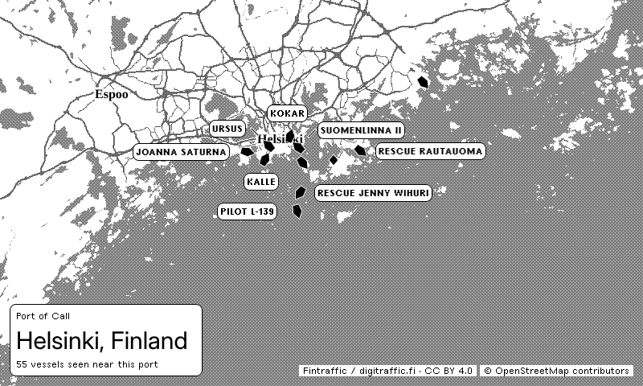
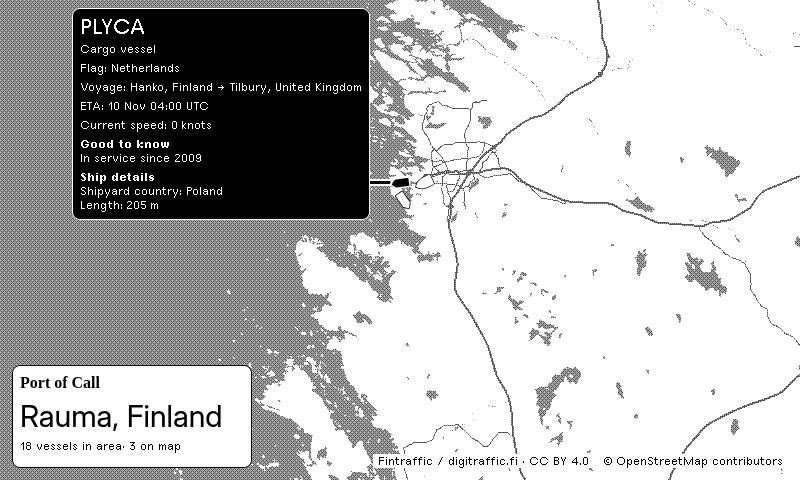

# Port of Call

**Harbor Arrivals & Departures · See who's coming and going.**

A map-first TRMNL recipe showing **observed AIS positions**, not authoritative port schedules. The primary private-beta catalog now covers **13 major US, European and Singapore harbor areas**. A separate open-data profile retains **Helsinki, Turku and Rauma, Finland**. One shared backend serves every installation; users never need AIS keys.

**AIS can be incomplete, delayed and inaccurate. Not for navigation.** A vessel marker is an observation, not proof of an arrival, departure or berth. Hulls point to true heading when available, otherwise course above 0.5 knots; diamonds have no useful orientation. Hollow hulls indicate reports older than 30 minutes. The count is distinct vessels with recent reports in the selected observation area near the port, rather than a complete physical port census or the number of visible glyphs.



This is a browser preview with native TRMNL vector tiles and **genuine historical AIS**, captured 4 November 2026. It is not current traffic. [All previews and provenance](docs/screenshots/README.md).




**Ship Spotlight** adds a floating, connected ship annotation alongside the bottom-left harbor card. It highlights one recent ship in black and keeps context vessels grey, with a native inverse annotation ordered as type, flag, reported voyage/ETA, current speed, sourced highlights and ship details. The port card shows port/country and the recent report count; source credits sit on the map. Previous port stays unknown unless a relevant official record supports it. This example is an archive, not current traffic. [Selection, freshness and free-source details](docs/ship-spotlight.md) · [Ranked overlay facts for review](docs/ship-spotlight-content.md).

## What works

- Gzip-aware shared Digitraffic polling, position/static normalization, SQLite persistence, bounded retention and outage recovery.
- Public JSON API, 30-second response cache, ETags and rate limiting; typical response below 15 KB.
- Native `TRMNLMaps` / MapLibre, geographically anchored hulls, Hotspots-style outlined name/voyage labels and leader lines, decluttering and visible OpenStreetMap attribution.
- Downstream-style full maps with a bottom-left information box in full, half-horizontal, half-vertical and quadrant layouts; OG and X landscape/portrait browser previews, including dark mode.
- Optional multi-select harbors (none cycles through every harbor, several cycle through those, one pins it), a fixed zoom-11 map centred on each port's curated harbor focus, **Show ship labels?**, **Spotlight a ship** and **Show port facts?** settings. The map runs edge to edge (`no_screen_padding: 'yes'`), with the harbor card and credits inset from the edge. Categories are retained internally but not exposed: type coverage is not sufficient to hide unknown vessels confidently.
- An isolated synthetic demo endpoint, disabled by default. Production never loads fixtures.

The Finnish catalog is deliberately limited, not the full reach of its feed: a further live check found reports around Hanko, Kotka, Oulu, Vaasa and Pori. Those candidate areas are not yet reviewed catalog entries.

A [major-harbor AISStream profile](docs/major-ports.md) now has genuine coverage evidence for **13 areas: six European, six US and Singapore**. Shanghai/Yangshan and Busan New Port had zero reports in the 15-minute window and are excluded. Build the private-test profile with `python scripts/package_recipe.py --provider aisstream`; its backend requires a securely bound key. The bounded display-proxy scope is reviewed against AISStream’s current FAQ; this is not a general open-data licence.

The **Cloudflare Workers Free backend** is deployed, reusing the Python domain code with a SQLite-backed Durable Object per profile. [Setup and free-plan limits](docs/cloudflare.md). GitHub Pages hosts the setup guide and links to the recipe source files, while the collector runs on Cloudflare. The Finnish backend is **deployed and verified** at https://port-of-call.5g5wqr7kzx-466.workers.dev. All eighteen harbor/framing/Spotlight combinations and the first public monitor run passed. A hosted TRMNL import/device test is still pending; no TRMNL account access was provided. The ready-to-copy [recipe settings](settings.yml) use the verified world backend, including Finnish ports, for all sixteen harbors. Use the [copy-and-paste guide](docs/copy-paste.md) to update your private plugin directly from GitHub. New streams need time to receive static/voyage metadata, and an area can show no observations during cold start. [Release gates](docs/release-checklist.md).

## Run locally

Python 3.12+; Node 24 is only needed for recipe tests and previews.

```sh
python -m venv .venv
.venv/bin/pip install -r requirements.txt
.venv/bin/pip install --no-deps -e .
.venv/bin/port-of-call
```

No key is needed. The process reads exported variables; it **does not automatically load `.env`**. Safe defaults are in [.env.example](.env.example). The first poll normally takes a few seconds. The SQLite directory is created automatically.

```sh
curl -f http://127.0.0.1:8080/health
curl -f 'http://127.0.0.1:8080/api/v1/vessels?harbors=helsinki,turku'
```

`/health` returns 503 until a successful fetch and when its last success is at least 60 minutes old. The snapshot endpoint still returns a deliberate `warming`, `empty`, `stale` or `unavailable` state. A successful HTTP fetch is distinct from the time of the latest vessel report. Configure `FRESH_SECONDS=1800`, `EXPIRE_SECONDS=3600` and `POLL_SECONDS=300` as needed; fresh must be shorter than expiry. Use a separate `DB_PATH` for each provider.

## Test as a private TRMNL plugin

Follow the [copy-and-paste guide](docs/copy-paste.md). The GitHub files already contain the live backend settings.

1. Paste [custom_fields.yml](custom_fields.yml) into Custom Fields.
2. Paste [shared.liquid](shared.liquid), [full.liquid](full.liquid), [half_horizontal.liquid](half_horizontal.liquid), [half_vertical.liquid](half_vertical.liquid) and [quadrant.liquid](quadrant.liquid) into their matching editor tabs.
3. Use the polling URL and other plugin values from [settings.yml](settings.yml). Save, choose your harbors, and refresh.
4. Check all layouts and light/dark mode on your device. Hosted-device validation remains a release check.

## Tests and previews

```sh
.venv/bin/python -m unittest discover -s tests -v
npm ci
npm test
npm run package
```

Offline tests use explicitly identified fixtures. To refresh **historical test captures** from the real provider:

```sh
.venv/bin/python scripts/capture_real.py
# Independently refresh richer Spotlight archive examples:
.venv/bin/python scripts/capture_spotlight.py
```

This overwrites the three captured fixtures and their metrics intentionally. Never replay them into production. State-test fixtures deliberately alter the state of a historical capture; demo positions are fully synthetic.

For actual native-map browser screenshots (network required):

```sh
.venv/bin/python scripts/assets.py
npx playwright install chromium
npm run preview
# another terminal
npm run screenshots
# Optional multi-instance layout regression check
node scripts/check-mashups.mjs
```

The pinned preview assets come from the official framework Git commit recorded in `scripts/assets.py`. On managed machines where Chromium must use an HTTP proxy, run `.venv/bin/python scripts/asset_proxy.py` and set `MAP_RELAY=true` for screenshots. This local-only TLS-verifying relay allows only the native TRMNL asset/tile hosts. It is not deployed. `PLAYWRIGHT_BROWSERS_PATH` may select an existing browser installation.

## Sources, rights and cost

**Free data sources only.** Paid subscriptions, API credits and paid-upgrade dependencies are out of scope. Ship Spotlight uses existing AIS fields and optional cached free enrichment; previous-port history is shown only where a suitable free source supplies it. See [Ship Spotlight](docs/ship-spotlight.md) and the [free sources](docs/enrichment-sources.md).

The local default and Finnish alternative use [Fintraffic / Digitraffic](https://www.digitraffic.fi/en/marine-traffic/), [CC BY 4.0](https://creativecommons.org/licenses/by/4.0/). Positions are validated, filtered and rounded to about one metre; static metadata is joined by MMSI. Attribution, source and license links are in the recipe and API. Data carries no accuracy or availability warranty. Map data: © OpenStreetMap contributors, ODbL; native TRMNL attribution remains visible.

AISStream's adapter was **live-tested for 15 minutes**, with 12,380 messages and 2,833 distinct per-area vessel observations across 13 areas. Its current FAQ explicitly supports server-side display proxies. The scoped review in `deploy/aisstream-rights.json` enables our temporary latest-value display cache; no general open-data, archive or resale licence is claimed. Its key and reviewed `AISSTREAM_RIGHTS_CONFIRMED=true` gate remain required. [Data evaluation](docs/data-source-evaluation.md) records evidence and exact blockers.

The collector needs persistent storage and ongoing collection. The Cloudflare route uses one Python Worker/SQLite Durable Object, memory ingestion and bounded batch checkpoints to fit published free allowances; the original VM route remains available. No paid plan or automatic paid upgrade is configured. The deployed service passed initial verification; actual free capacity and multi-day reliability still need to be measured. See [Cloudflare setup and quota arithmetic](docs/cloudflare.md). There is no per-user AIS subscription in the default Finnish workflow. Upstream AIS polling stays at 288 shared location fetches/day and 24 metadata fetches/day; optional Finnish Portnet adds at most 24/day, while cached Wikidata has a hard 500-request/day cap, independent of recipe installations. See [architecture](docs/architecture.md), [deployment](docs/deployment.md) and [roadmap](docs/roadmap.md).

Code is MIT licensed. Data and third-party frameworks retain their own licenses; see [NOTICE](NOTICE).

## Compact ship labels

Turn on **Show ship labels?** for outlined name/voyage badges in both harbor overview and Ship Spotlight. The name is bold above a divided voyage row, with native canvas/inverse theme behavior. Ordinary labels use country codes to stay compact; Spotlight retains full country names. A supported previous port and destination become `Hanko, FI → Tilbury, GB`; destination alone becomes `To Tilbury, GB`. Missing voyage data leaves a name-only badge. The current harbor is never assumed to be a ship's origin. Long lines truncate inside the badge, and the full label text stays in its tooltip/API.

[Overview preview](docs/screenshots/labels-overview.png) · [Spotlight with context labels](docs/screenshots/labels-spotlight.png) · [Dark preview](docs/screenshots/labels-spotlight-dark.png). These use genuine **archived** AIS from 5 November 2026, not current traffic.


**Show port facts?** adds an optional short blurb below the vessel count. The curated collection rotates hourly, with sources retained in API metadata and [documentation](docs/port-facts.md). It is off by default and omitted in the smallest half-horizontal/quadrant layouts. Credits use native inline map-attribution backgrounds, covering only their text. `LVMRX` resolves to **Mērsrags, Latvia**; the exact free-text destination `FAIRWAY WORKS` displays as **Activity: Fairway works**, not a voyage to a fictional port. Raw source values and inferred-flag provenance remain available in the API, without an “(AIS)” suffix on screen.
