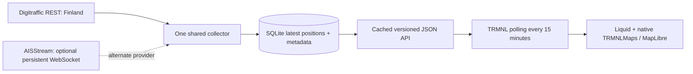

# Architecture and decisions

## Why this architecture

A licensed snapshot API proved viable for a restricted Finnish catalog. Polling it every five minutes is simpler than continuously collecting worldwide events. The ingestion task and HTTP API run in one asynchronous Python process; SQLite/WAL lives on durable local disk. There is no Redis, Worker, scheduler or per-installation subscription. One process per database is required. Native map tiles are requested by TRMNL's renderer, not by the backend.

Default settings select only the verified Finnish catalog. IDs are application slugs, **not claimed UN/LOCODE identifiers**. The reviewed versioned registry carries geographic boxes, centers, timezones and provider scope. A bounding rectangle describes an observation area, not an official harbor boundary. Wider uses the full collected box; Standard uses 76% of each dimension and Closer uses 48%. Smaller layouts retain the same known extent rather than following vessels. `TRMNLMaps.fit` chooses an integer zoom, so additional coastline can appear beyond it.

The alternative AISStream adapter creates one long-lived compressed connection for the three research boxes. It sends the subscription immediately, handles binary/text frames, stores last observations and reconnects with exponential backoff/jitter up to five minutes. Do not start multiple replicas: the source documents three subscribed connections/account and three open connections/IP. A short-lived cron sample cannot provide a complete snapshot. The adapter has parser tests but **no credentialed stream test**; deployment must prove its schema, coverage and display rights first.

## Data and freshness

- All coordinate arrays are **[longitude, latitude]**. AISStream subscription corners are explicitly **[latitude, longitude]**.
- MMSI-keyed dynamic and static tables have independent timestamps. Older/equal dynamic observations cannot replace newer ones. Static metadata never moves a vessel or refreshes its position age. Unavailable AIS values (511 heading, 360 course, 102.3 knots) become null.
- No future dynamic timestamps are accepted. Positions at least 60 minutes old are rejected/expired. Names/type metadata older than seven days is removed. Static metadata refreshes hourly and cannot be future dated.
- TimestampExternal in Digitraffic **REST** positions is milliseconds; AIS seconds-within-minute is not a report date. AISStream uses `MetaData.time_utc`; missing dates are rejected rather than invented from receipt time.
- At 30 minutes, old markers become hollow and the area becomes stale if its newest observation is old. A failed poll retains prior data within the bounded window. After 60 minutes without a successful fetch, the endpoint hides all positions and reports unavailable. After an empty successful fetch with no unexpired stored positions it says "No recent vessel reports", never "No ships".
- `snapshot_at` is JSON generation time. `fetched_at` is the last successful provider fetch; `latest_report_at` is the latest observation in the selected area. The UI shows both fetch and report local times with timezone abbreviations. Refreshing JSON never re-dates reports.
- Latest positions are pruned on successful polls and reads always enforce expiry, including during an outage. Expired rows on disk can remain until the next successful prune; they cannot reappear on the map.

## API and limits

`GET /api/v1/harbors` lists the active provider's registry. `GET /api/v1/harbors/{id}/vessels?scale=closer|standard|wider` returns schema version 1. Unsupported IDs return 404; invalid scales return 400. `GET /health` reports readiness/counters and no credentials. `GET /demo/api/v1/harbors/{id}/vessels` requires `ENABLE_DEMO=true` and always includes `demo:true` and a synthetic source. Public routes cannot access fixtures.

Snapshots contain port, viewport, source/attribution, status/message, freshness timestamps, total/shown/omitted counts and normalized vessels. Vessel fields: MMSI, optional name/type, position, reported_at, nullable heading/course/speed, selected bearing and stale flag. 40 vessels maximum; deterministic spatial round-robin favors distribution and recency rather than one dense berth. Responses must fit 20 KB, normally below 15 KB. The UI performs additional pixel-space decluttering and announces its shown/total count. Hidden markers are not reported as absent vessels. Labels are capped at six on full screens and disabled on compact screens.

JSON is shared in 30-second buckets, with 30-second public caching, ETags and at most 60 seconds of downstream stale-if-error tolerance. The in-process cache has at most 64 keys. A 120 requests/minute/IP limiter bounds traffic with at most 4,096 in-memory client buckets. Do not trust arbitrary forwarded IP headers; if placing behind a shared reverse proxy, add a provider edge limiter/cache for scale. Per-IP limits are coarse abuse protection, not an authentication mechanism.

## Security and operation

No user identifiers or vessel history are retained. IP rate counters are transient; HTTP access logging is disabled. Logs contain provider state, aggregate accepted/rejected counts, per-harbor counts/report age and exception class, never upstream response bodies, API keys or headers. SQLite cache is operational data, not a historical tracking service.

Secrets are server-side environment bindings. No credentials are needed by Finnish recipe users. Input scales/harbors are allowlisted, names are bounded/control-character stripped, Liquid attributes escaped and labels inserted as textContent. JSON never embeds markup. No arbitrary backend URL is accepted by the public API.

One active backend serves many devices. Back up SQLite with its online backup API; do not copy an active main file without its WAL. When changing providers, use a new database: source binding prevents attribution mixing. Monitor health, report ages, counters, disk and request volume. Restart persistence is tested. Hosting failover, load testing and a multi-day coverage/uptime study remain deployment checks.

## Extension boundaries

The normalization layer does not depend on TRMNL and the snapshot has `display_mode: map`. Add separately licensed port-call adapters and `/port-calls` without inferring schedules from position history. Spotlight can reuse MMSI metadata behind its own payload. Board/spotlight controls remain hidden until they work. Avoid adding fake ETAs, flag facts or generated voyage claims to the position model.
