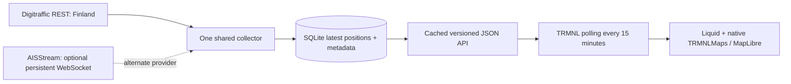

# Architecture and decisions

## Why this architecture

A licensed snapshot API proved viable for a restricted Finnish catalog. Polling it every five minutes is simpler than continuously collecting worldwide events. The ingestion task and HTTP API run in one asynchronous Python process; SQLite/WAL lives on durable local disk. There is no Redis, Worker, scheduler or per-installation subscription. One process per database is required. AISStream position and feed-health writes share a transaction committed about every five seconds; normal shutdown commits pending work, while an abrupt host/process failure can lose the final uncommitted batch. Native map tiles are requested by TRMNL's renderer, not by the backend.

Default settings select only the verified Finnish catalog. IDs are application slugs, **not claimed UN/LOCODE identifiers**. The reviewed versioned registry carries geographic boxes, centers, timezones and provider scope. A bounding rectangle describes an observation area, not an official harbor boundary. The recipe always uses the `harbor` framing: map zoom 11 (12 on the 2x TRMNL X), centred on a curated `focus` point per harbor, so ships keep the same apparent size everywhere. The backend's `viewport` is what zoom 11 shows on an 800×480 screen around that point, and the payload's `camera` carries the zoom and centre for the map. Focus points were reviewed against live AIS renders of all 16 verified areas; the box centre often missed the actual harbor (Helsinki, Rotterdam, Savannah). Half and quadrant views keep zoom 11 and show the harbor core. The single-harbor API still accepts Wider (full collected box), Standard (76%) and Closer (48%), which fit the box instead. In overview, smaller layouts retain the same known extent. Optional Spotlight frames the current subject with context at the selected scale, while the observed candidate pool remains the reviewed harbor box. `TRMNLMaps.fit` chooses an integer zoom, so additional coastline can appear beyond it.

The alternative AISStream adapter creates one long-lived compressed connection for the verified AISStream catalog (up to the application cap of 15 areas). It sends the subscription immediately, handles binary/text frames, stores last observations and reconnects with exponential backoff/jitter up to five minutes. Do not start multiple replicas: the source documents three subscribed connections/account and three open connections/IP. A short-lived cron sample cannot provide a complete snapshot. The adapter has parser tests and a separate, manually invoked secret-backed coverage probe; deployment still needs account-specific evidence, reviewed map extents and confirmed display rights. See [major-ports.md](major-ports.md).

## Data and freshness

- All coordinate arrays are **[longitude, latitude]**. AISStream subscription corners are explicitly **[latitude, longitude]**.
- MMSI-keyed dynamic and static tables have independent timestamps. Older/equal dynamic observations cannot replace newer ones. Static metadata never moves a vessel or refreshes its position age. Unavailable AIS values (511 heading, 360 course, 102.3 knots) become null.
- No future dynamic timestamps are accepted. Positions at least 60 minutes old are rejected/expired. Names/type metadata older than seven days is removed. Static metadata refreshes hourly and cannot be future dated.
- TimestampExternal in Digitraffic **REST** positions is milliseconds; AIS seconds-within-minute is not a report date. AISStream uses `MetaData.time_utc`; missing dates are rejected rather than invented from receipt time.
- At 30 minutes, old markers become hollow and the area becomes stale if its newest observation is old. A failed poll retains prior data within the bounded window. After 60 minutes without a successful fetch, the endpoint hides all positions and reports unavailable. After an empty successful fetch with no unexpired stored positions it says "No recent vessel reports", never "No ships".
- `snapshot_at` is JSON generation time. `fetched_at` is the last successful provider fetch; `latest_report_at` is the latest observation in the selected area. The API retains both fetch and report local times with timezone abbreviations; the product cards omit these clock rows. Refreshing JSON never re-dates reports.
- Latest positions are pruned on successful polls and reads always enforce expiry, including during an outage. Expired rows on disk can remain until the next successful prune; they cannot reappear on the map.

## Map layout and reusable labels

The layout follows the user’s Downstream recipe: the native `outline` preset fills each view, and a small `bg--canvas outline` information box sits bottom left. Native framework typography, spacing and responsive width classes replace the separate custom header/footer. Framing reserves the area beside or above the box (whichever is larger), using the known harbor bounds and integer zoom. It never follows an outlying vessel or invents an alternate ship location.

The leader-label algorithm was adapted from `nikokoren/hotspots`, `trmnl/src/shared.liquid` (`HSMap.placeLabels`, commit `dba7f701042a81eaaa62a31f200169869256b145`) at the user’s explicit request. Downstream’s framing and native card were taken as the reference from `recipe/src/shared.liquid`, commit `0e89ed63a801a795a05d96e90c6722631c697d6a`. Both source checkouts remain unchanged. The label planner is embedded in Shared so the import still needs only six files; it has pure geometry tests as well as final-pixel browser checks. Exact segment/rectangle intersection improves on sampled leader checks for narrow obstacles. All custom CSS concerns geographic overlays, stacking or link inheritance; presentation uses native framework classes.

## API and limits

Built-in POIs come from a reviewed 97-place CC0 catalog. Associations with the current `port_fact.id` order its candidates first and add `fact_related:true`; at most eight candidates travel in the snapshot, without the full internal association lists. Forwarded Finnish snapshots recompute the associations after applying the world backend's fact-rotation period. The client reserves related POI label space before ordinary ship names only when the optional fact is visible, then places other landmarks after names. Hulls, Spotlight and fixed cards/credits stay protected. The existing one/two-visible-POI cap and fixed camera remain. [Fact-by-fact review and coordinate sources](port-fact-pois.md).

`GET /api/v1/harbors` lists the active provider's registry. `GET /api/v1/vessels?harbors=a,b&spotlight=true|false` is the recipe endpoint: an empty selection means every active harbor, unknown IDs are ignored, one ID is always shown, and several rotate in catalog order once per 15-minute wall-clock slot (the recipe refresh interval), so consecutive refreshes step through the selection while responses stay cacheable. `GET /api/v1/harbors/{id}/vessels?scale=closer|standard|wider` remains for existing installations and direct API use. Both default to legacy schema version 1 (40 object markers). The current recipe opts into `format=map`, schema version 2 with up to 80 compact marker records; unknown formats return 400. The catalog advertises `capabilities.compact_map` and `map_candidate_limit`. Unsupported IDs return 404; invalid scales return 400. `GET /health` reports readiness/counters and no credentials. `GET /demo/api/v1/harbors/{id}/vessels` requires `ENABLE_DEMO=true` and always includes `demo:true` and a synthetic source. Public routes cannot access fixtures.

Snapshots contain port, observation viewport, fixed camera, source/attribution, status/message, original freshness timestamps, total/shown/omitted counts and normalized vessels. Legacy vessel objects retain MMSI, optional name/type, coordinates, report time, heading/course/speed, selected bearing and stale flag. Map-format `marker_fields` defines the array columns: `mmsi`, `position`, `bearing_deg`, `speed_knots`, `type`, `name`, `length_m`, `reported_at`, `stale`, `label_rank`, `voyage`. Report times use Unix seconds, preserving the original second; coordinates, zero values and false flags are preserved. Raw heading/course/navigation fields stay in the backend; the computed display bearing and full Spotlight facts/provenance are retained. The templates accept both formats.

The compact pool selects up to 64 candidates from the unchanged 800×480 core with deterministic spatial round-robin and the existing interest score. Up to 16 more cover the surrounding 1400×1400 logical-pixel envelope, clipped to collected source coverage, so portrait/X views and card offsets have actual source positions around the edges. Spare capacity is filled from the core. Spotlight is reserved first and counts toward 80. This does **not** move or fit the map: `camera` remains the curated fixed center/zoom, and the client still projects every real coordinate. The expanded observation `viewport` defines the area count for this format; it is not a port boundary or on-screen count. Legacy queries retain their original core and 40-candidate cap.

Every encoded response stays below 15,000 UTF-8 bytes, including non-ASCII names. Optional landmarks, port fact, ordinary voyage rows and trail yield before candidate coordinates under exceptional byte pressure; the featured marker is retained. Packing removes repeated JSON keys instead of dropping display details. The client still omits out-of-frame positions, overlay conflicts and ship centers closer than 16 logical pixels. Its “X on map” count reflects the final visible hulls. Name quotas remain area-scaled (at standard sizes: OG full/half/quadrant 8/4/2, X 16/8/4), rather than increasing with the candidate pool. Label placement uses adjacent positions and leader lines that avoid hulls, overlays and existing labels; it never moves the vessel.

JSON is shared in 30-second buckets, with 30-second public caching, ETags and at most 60 seconds of downstream stale-if-error tolerance. The in-process cache has at most 64 keys. A 120 requests/minute/IP limiter bounds traffic with at most 4,096 in-memory client buckets. Do not trust arbitrary forwarded IP headers; if placing behind a shared reverse proxy, add a provider edge limiter/cache for scale. Per-IP limits are coarse abuse protection, not an authentication mechanism.

## Security and operation

No user identifiers or vessel history are retained. IP rate counters are transient; HTTP access logging is disabled. Logs contain provider state, aggregate accepted/rejected counts, per-harbor counts/report age and exception class, never upstream response bodies, API keys or headers. SQLite cache is operational data, not a historical tracking service.

Secrets are server-side environment bindings. No credentials are needed by Finnish recipe users. Input scales/harbors are allowlisted, names are bounded/control-character stripped, Liquid attributes escaped and labels inserted as textContent. JSON never embeds markup. No arbitrary backend URL is accepted by the public API.

One active backend serves many devices. Back up SQLite with its online backup API; do not copy an active main file without its WAL. When changing providers, use a new database: source binding prevents attribution mixing. Monitor health, report ages, counters, disk and request volume. Restart persistence is tested. Hosting failover, load testing and a multi-day coverage/uptime study remain deployment checks.

## Extension boundaries

The normalization layer does not depend on TRMNL and the snapshot has `display_mode: map`. Add separately licensed port-call adapters and `/port-calls` without inferring schedules from position history. Spotlight is now an optional Map setting, using validated field-level facts, bounded persistent selection history and cached free enrichment. Its subject is reserved before response truncation. The board control stays hidden until real schedules work. See [Ship Spotlight](ship-spotlight.md). Avoid adding fake ETAs, flag facts or generated voyage claims to the position model.

## Spotlight API and storage

`?spotlight=true` enables shared ship focus (`false`/empty is overview; boolean on/off, yes/no and 1/0 are accepted). Invalid values return 400. Cache keys include normalized focus and scale. Existing clients can ignore the additive `focus_requested`, `focus_mode`, `focus_message` and nullable `focus` fields. `focus` carries identity, position/report times, selection window/reason, bounded facts with individual source/time, reported destination/ETA, optional origin, resolved destination and reference enrichment. Overview markers omit rich fact maps to preserve the 15 KB budget; the featured marker is first and never removed by byte trimming.

Existing SQLite databases migrate additively on startup: `vessel_facts`, `focus_current`, `focus_history`, `enrichment` and `port_calls`. No reset or position replay is needed. All request-time reads enforce expiry during outages. One asynchronous free-enrichment worker uses a bounded deduplicated queue and persisted request budget. Portnet and Wikidata failures are isolated from the position collector. The server needs outbound HTTPS to `www.wikidata.org` and, for Finnish enrichment, `meri.digitraffic.fi`; no new credentials.

## Independent Spotlight annotation

The bottom-left harbor key and `[data-poc-spotlight]` are independent native cards. The extended-label planner shares the Hotspots geometry helpers but treats context hulls as soft obstacles, rather than dropping them to make annotation space. It reserves the featured hull, harbor key and map credit, and always returns a leader line. The regular label pass reserves the resulting card and line. Grey smaller context hulls contrast with the black subject; one-bit contexts use hollow hulls. The API keeps total/shown/omitted information; the visible port-card count describes distinct recent reports in the selected area, including vessels hidden by decluttering or the annotation. The backend payload and shared selection period are unchanged by this presentation revision. See the [ranked content recommendation](ship-spotlight-content.md).

Country-aware enrichment adds `eta_estimate`, provenance-bearing `flag`, optional `registry_country` and `built_in`, and country names on resolved ports/origin. Radio-country lookups use P2979; registry and actual-yard references use P8047/P1071/P176/P17. All remain on the bounded background queue and versioned `v2:` cache. Snapshot generation never performs these network lookups. Existing clients can ignore the additive fields; the byte budget still protects the featured marker. Historical fixtures keep observation time separate from later reference retrieval. See the exact [ETA and country semantics](ship-spotlight.md#country-labels-and-eta-inference--5-november-follow-up).

The accepted native-framework design pass removes the fixed ship-card color/maximum-width overrides. Native `inverse`, responsive auto/min/max width, title/label roles and flex/spacing now govern the annotation's presentation. Geographic placement still measures its rendered dimensions. All metadata shares one native small-label text size, with bold labels and inline labeled dimensions, and the Spotlight SVG connector uses a UI-scale-aware 3px stroke / 7px halo; ordinary label leaders remain unchanged. The port card now follows the requested port/country/count copy, with Fintraffic/source and OpenStreetMap credits in the map footer and optional Wikidata/CC0 credit in About/settings. A native flex row docks the port card and wrapping credits at the bottom edge without credit-driven vertical offsets.

The snapshot adds `focus.presentation` through the pure `display.focus_copy` formatter. It supplies ordered copy from validated source facts, a reported origin/destination story that omits unknown components, preserved zero speed, optional factual highlights and construction/measurement details. Original metadata and provenance remain available alongside it. Service year does not become construction year. Recipe and backend should be upgraded together for the new presentation field. Source links live in author-provided native `.map__attribution` markup; the framework leaves it intact. Its wrapped bounds join the map's protected overlays.

## Cloudflare runtime

The optional [Cloudflare Free deployment](cloudflare.md) reuses the existing Python domain modules. A store interface isolates direct SQL access; `MemoryStore` has snapshot/expiry/rotation parity tests against SQLite. One Durable Object ingests continuously in memory and atomically checkpoints bounded ASCII chunks every five minutes to avoid per-message SQL write quotas. Selection changes and the daily Wikidata budget persist immediately. Durable one-minute alarms handle maintenance/reconnect; initial health probes start collection and requests/the hourly monitor restore missing alarms; public snapshots never wait for source collection. The public Worker adds a 30-second edge cache. A native workerd CI smoke test exercises the actual Python runtime and SQL bindings. Hosted deployment, actual free-tier usage, AISStream native streaming and multi-day behavior remain deployment checks.

## Ordinary name/voyage badges

Optional per-marker `voyage` strings derive from validated unexpired AIS facts, cached exact port references and relevant actual Portnet calls. Snapshot generation batches the call-record read and performs no additional upstream lookups per vessel. Countries use known UN/LOCODE prefixes in compact badges; Spotlight keeps full names. Missing origin/destination components never become guessed routes. The shared `payload.encode_snapshot` first removes optional ordinary voyage strings under byte pressure, then applies the existing marker cap/budget logic; coordinates and the featured hull take priority over extra label detail in both server runtimes.

Each badge uses native canvas, outline, padding and small-label typography, with a bold name and a divided voyage line. The existing Hotspots-derived planner reserves the whole box plus its native font-pass safety margin. Badges and leaders avoid hulls, port/Spotlight cards, map credits and one another. Long text uses a bounded box and ellipsis; a full-text tooltip retains the content. Labels Off and all prior polling settings stay compatible. The label toggle is now titled **Show ship labels?**.
